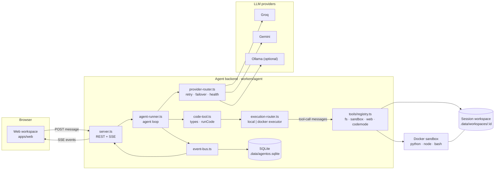
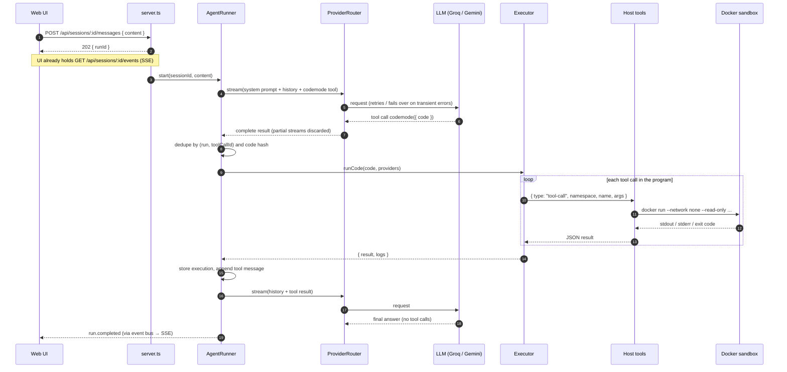

# AgentOS

An AI workspace where you describe a task in natural language, and an LLM writes **one JavaScript program** that orchestrates typed tools. The program runs in an isolated executor, calls Python / Node.js / shell inside Docker, and every step is traced live in the UI. This is Cloudflare's **Code Mode** pattern (`@cloudflare/codemode`), running on free-tier and local infrastructure.

**New here?** Open the **How it works** page in the app (`/#how-it-works`), then read [System design](#system-design). Contributors and coding agents: see [AGENTS.md](AGENTS.md).

```
React workspace ──SSE──▶ Agent backend ──▶ LLM router ──▶ Groq ─(fails over)─▶ Gemini ─▶ (Ollama, optional)
 (Vite, Tailwind,          (Express, Zod,      │
  shadcn/ui, Monaco)        SQLite)            ▼  one `codemode` tool call: { code }
                                          Code Mode (@cloudflare/codemode: types, normalizeCode, runCode)
                                               │
                                          Execution router ──▶ local worker-isolate executor   (default, dev)
                                               │           └─▶ Docker container executor       (CODEMODE_EXECUTOR=docker)
                                               ▼  tool calls from the program
                                          fs.* · sandbox.runPython/runNode/runShell/installPackage · web.fetch · codemode.searchTools
                                                         └─▶ Docker sandbox (no network, read-only, limits)
```

## Quick start

Requirements: Node ≥ 22.13 (uses built-in `node:sqlite`), Docker, and at least one of a Groq key, a Gemini key, or a local Ollama.

```bash
npm install
npm run sandbox:build          # builds agentos-sandbox:latest (Python 3 + Node 24 + bash)
cp .env.example .env           # add GROQ_API_KEY and/or GEMINI_API_KEY
npm run dev                    # agent on :8787, web on :5173
```

Open http://localhost:5173.

**Docker Compose** (builds the sandbox image, agent and web; UI on http://localhost:8080):

```bash
docker compose up --build
docker compose --profile ollama up --build   # also starts an Ollama container
WEB_PORT=8088 docker compose up --build      # if port 8080 is taken
```

The agent container starts sandbox containers as siblings through `/var/run/docker.sock`. That gives it control of the host Docker daemon, which is fine for local development but not for multi-tenant hosting.

## System design

> New to the project? Open **How it works** in the app (header link, or http://localhost:5173/#how-it-works). It replays one run step by step, with a toggle that shows a Groq → Gemini failover. It is scripted, so it works without API keys.

### Goals

1. Let a model do multi-step work with **one round trip per plan**, not one per tool call.
2. Run model-written code **without trusting it**.
3. Keep working when a free-tier provider rate limits, **without changing the agent's behaviour** and **without ever running a program twice**.
4. Make every step **observable and replayable** in the UI.

### Why Code Mode

Classic tool calling makes the model emit one JSON tool call, wait for the result, read it, emit the next. Every intermediate result passes back through the context window. Code Mode turns the tool catalog into TypeScript declarations and gives the model a single `codemode` tool. The model writes the whole plan as a program, with loops, conditionals and `Promise.all`. Intermediate values stay inside the program, and only the final return value goes back to the model.

| | Classic tool calling | Code Mode |
|---|---|---|
| LLM calls for "run Python, then a shell command on its output, then answer" | 3 | 2 |
| Tools visible to the model | every tool, as JSON schemas | one tool; the rest are a typed API in its description |
| Control flow | the model, one step at a time | real JavaScript |
| Intermediate results in context | all of them | only what the program returns |

### Components



| Component | Responsibility | Must not |
|---|---|---|
| Web workspace | Chat, execution cards, inspector, provider status, How it works page | hold secrets or call providers |
| `server.ts` | REST routes, SSE stream with replay, zod validation | contain agent logic |
| `agent-runner.ts` | The loop: build request → router → execute `codemode` calls → append results → repeat (max `LLM_MAX_AGENT_STEPS`) | execute anything before a provider call fully succeeds |
| `providers/` | One `LLMProvider` interface over Groq / Gemini / Ollama, error classification, retry, failover, health | run code |
| `codemode/` | Generate types from tool schemas, define the `codemode` tool, run programs via `@cloudflare/codemode` `runCode` | expose host objects to the program |
| Executors + `codemode-runtime.mjs` | Run the program in a fresh V8 context (worker thread) or a container; forward tool calls to the host as JSON | allow `require`, `process`, `fetch`, `eval`, Wasm |
| `tools/registry.ts` | The host functions programs can call; validates args and reports each call | trust program input |
| `sandbox/` | Docker runner, workspace path safety, package allowlist | give containers network (except allowlisted installs) |
| `db/` + `event-bus.ts` | Persist sessions, runs, messages, executions, events; fan events out to SSE | drop persisted events |

### Request lifecycle



Each arrow that changes state also emits an event (`run.started`, `llm.request`, `provider.retry`, `provider.failover`, `assistant.delta`, `assistant.message`, `execution.started`, `tool.call`, `tool.result`, `execution.log`, `execution.output`, `execution.completed`, `execution.deduplicated`, `run.completed` / `run.failed` / `run.cancelled`). Text deltas are live-only; everything else is persisted.

### Data model

SQLite via `node:sqlite`, one file, `<DATA_DIR>/agentos.sqlite` (default `.data/`).

| Table | Key columns | Purpose |
|---|---|---|
| `sessions` | `id`, `title`, `updated_at` | A conversation and its workspace directory |
| `runs` | `id`, `session_id`, `status`, `provider`, `model`, `error` | One user message and everything it triggered |
| `messages` | `session_id`, `role`, `content`, `tool_calls`, `tool_call_id`, `provider`, `model` | Provider-neutral history replayed to whichever provider serves the next request |
| `executions` | `run_id`, `tool_call_id`, `code`, `code_hash`, `status`, `result`, `logs`, `executor` | Every program run; the basis for idempotency and the History tab |
| `events` | `id` (monotonic), `run_id`, `session_id`, `type`, `data` | The UI timeline; `id` is the SSE `Last-Event-ID` |

Session files live in `.data/workspaces/<session>/`, mounted at `/workspace` in the sandbox and listed as artifacts in the UI.

### Failure model

- **Provider errors** are normalized into a `ProviderError.kind`. The retry policy decides between *retry the same provider*, *fail over* and *fail*; see [Failover policy](#failover-policy-workersagentsrcproviders).
- **Exactly-once execution.** The router never executes code, so a retried or failed LLM call cannot run a program. Executions are unique per `(run, toolCallId)`, and after a provider switch a program whose normalized hash already completed in the run is reused (`execution.deduplicated`).
- **Program errors** (exceptions, tool failures, timeouts) come back to the model as `{ ok: false, error, logs }` so it can fix the code and retry, bounded by the step limit.
- **Interrupted runs.** `sanitizeHistory` gives any tool call without a result a synthetic "not executed" result, so the stored history stays valid for every provider.
- **Fake execution guard.** If the model pastes a program in its reply instead of calling the tool, the reply is discarded once and the model is told to run it.

### Security model

The program is untrusted, and so is anything it fetches.

| Layer | Boundary |
|---|---|
| Program context | Fresh V8 context; no `require` / `import` / `process` / `fetch`; string eval and Wasm off; only JSON strings cross; heap limit; wall-clock timeout kills the worker or container |
| Host tools | Arguments validated against the tool's input schema; `fs` confined to the session workspace (no `..`, no symlink escape) |
| Sandbox containers | `--network none`, read-only root, `--cap-drop ALL`, `no-new-privileges`, non-root user, memory / CPU / PID limits, small tmpfs |
| Package installs | Allowlist only, validated names / versions, argv not shell, npm `--ignore-scripts`, network only during the install |
| `web.fetch` | Public http(s) only; private, loopback, link-local and metadata IPs blocked after DNS and after each redirect; 200 KB cap |
| Secrets | Provider keys live only in the agent process; the browser sees names, models, health |

The `local` executor is a development adapter: `node:vm` is not a security boundary. Use `CODEMODE_EXECUTOR=docker` when the stronger boundary matters.

### Deployment

- **Local dev:** `npm run dev`. Agent on `127.0.0.1:8787`, Vite on `:5173` proxying `/api`.
- **Docker Compose:** nginx serves the web build and proxies `/api` to the agent container. The agent starts sandbox containers as siblings through the host Docker socket (`WORKSPACE_HOST_DIR` maps the data dir for mounts).
- **Cloudflare Workers (future):** the agent and executors already speak `@cloudflare/codemode`'s `Executor` interface. Moving means adding a `DynamicWorkerExecutor` in `codemode/execution-router.ts` and replacing SQLite / Docker with Workers equivalents; the agent loop does not change.

### Design decisions

| Decision | Why | Trade-off |
|---|---|---|
| One `codemode` tool instead of many tools | Fewer round trips, real control flow, smaller context | A program failure is coarser than a single tool failure; the model must fix and rerun |
| Own provider layer instead of an AI SDK wrapper | Precise error classification, failover mid-run, Gemini thought signatures | More adapter code to maintain |
| Provider-neutral history in SQLite | Any provider can continue any conversation | Foreign tool calls are replayed to Gemini as transcripts, not native calls |
| Execute only after a full provider response | Makes "never run twice" provable | No speculative execution while streaming |
| Two executors behind one interface | Fast local dev; container isolation when needed; Workers later | `local` is not a hard boundary |
| SSE with persisted events | Simple, reload-safe, replayable | One-way; actions use REST |

## LLM providers

| Role | Provider | Integration | Default model |
|---|---|---|---|
| Primary | Groq | OpenAI-compatible API `https://api.groq.com/openai/v1` (plain `fetch`) | `openai/gpt-oss-120b` |
| Fallback | Google Gemini | Official `@google/genai` SDK | `gemini-3.6-flash` |
| Optional | Ollama | OpenAI-compatible `/v1` endpoint | `gpt-oss:20b` |

Model choices were checked against the providers' docs in November 2026:

- `openai/gpt-oss-120b` is a Groq production model with tool use. Groq does not list parallel tool calls for it; AgentOS only needs one `codemode` call per step.
- `gemini-3.6-flash` is Gemini's stable Flash model with function calling and structured output. `gemini-2.5-flash` is deprecated. Free-tier limits differ by project and change often, so check AI Studio for yours.

No OpenAI or Anthropic credentials are used anywhere. All keys stay in the agent process. The browser only ever sees provider names, models and health.

The app runs with **Groq alone, Gemini alone, or both**. A provider without a key is listed as "No key" and never called. Ollama joins the chain when `OLLAMA_ENABLED=true`, or you can make it primary or fallback.

### Failover policy (`workers/agent/src/providers/`)

| File | Responsibility |
|---|---|
| `provider-interface.ts` | Common contract: text, streaming, tool calling, structured output, system prompt, history, error normalization |
| `groq-provider.ts`, `gemini-provider.ts`, `ollama-provider.ts` | Wire-format translation in both directions |
| `errors.ts` | Classifies every failure into a `ProviderError.kind` |
| `retry-policy.ts` | Retry on the same provider, fail over, or fail |
| `provider-router.ts` | Priority chain, failover, execution events |
| `provider-health.ts` | Availability, last success and error, consecutive failures, rate-limit status, retry-after, request counts |

| Failure | Retry same provider | Fail over |
|---|---|---|
| HTTP 429 (per-minute limit) | only if `Retry-After` ≤ `LLM_MAX_RETRY_WAIT_MS` | yes |
| HTTP 429 daily quota (Groq "per day (TPD/RPD)", Gemini `…PerDay…` quota id) | no | yes |
| HTTP 500 / 502 / 503 / 504, timeout, network error | yes, bounded (`LLM_MAX_RETRIES`, exponential backoff + jitter) | yes |
| Malformed tool call from the model (Groq `tool_use_failed`, Ollama "error parsing tool call", truncated stream) | yes, bounded | yes |
| HTTP 401/403 invalid key, malformed request, unknown/decommissioned model, context overflow | **no** | **no**: the error is shown to the user |

- A rate-limited provider is skipped until its retry-after time, then tried again automatically.
- Three consecutive transient failures open a 30 s circuit breaker.
- When every provider is down, the frontend gets `LLM_UNAVAILABLE` with each provider's reason and the earliest retry time.
- Remaining quota is never shown, because neither provider reports it for free-tier keys.

### Agent continuity across a switch

- Every provider receives the identical system prompt (including the Code Mode instructions), the full persisted conversation and the same `codemode` tool definition.
- Tool calls are normalized to one internal `ToolCall` shape.
- **Gemini thought signatures:** Gemini rejects replayed function calls without them. Calls Gemini made itself are replayed with their signatures. Calls made by Groq or Ollama are given to Gemini as plain-text transcripts ("already executed, do not re-run") followed by their stored result.
- **A program never runs twice because of a switch:**
  1. The router only talks to models. Code runs only after a provider call has fully succeeded, and partially streamed tool calls are discarded.
  2. Executions are keyed by (run, tool-call id), so the same call id never runs twice.
  3. After a switch, if the new provider emits a program identical to one that already completed in this run, the stored result is reused and an `execution.deduplicated` event is recorded.
- Failovers appear in the chat ("Groq rate limit reached. Switching to Gemini.") and in the execution timeline. Every assistant message and every execution records the provider and model that produced it.

## Code Mode

The agent uses the real `@cloudflare/codemode@0.5.6` APIs:

- `generateTypesFromJsonSchema` turns each tool namespace into TypeScript declarations for the prompt.
- `runCode` (which applies `normalizeCode`) executes the program through an `Executor`.
- `truncateResult` caps tool results before they go back to the model.

The LLM gets a single tool, `codemode`, with input `{ code }`; it never calls host tools directly. The package's main entry imports `cloudflare:workers`, so on Node a small shim (`workers/agent/src/shims/`) provides the three empty base classes it references.

**Executors.** Both implement the package's `Executor` interface (`execute(code, providers) → { result, error, logs }`) and share one runtime, `sandbox/codemode-runtime.mjs`.

| `CODEMODE_EXECUTOR` | What it is | Isolation |
|---|---|---|
| `local` (default) | **Development adapter.** A fresh V8 context in a worker thread | Empty env, no `require` / `process` / `fetch`, string-eval and Wasm disabled, only JSON strings cross the boundary, heap limit, hard timeout (thread terminated). `node:vm` is not a security boundary. |
| `docker` | The same runtime in a throwaway container | `--network none`, read-only root fs, `--cap-drop ALL`, no-new-privileges, memory / CPU / PID limits, hard timeout |

Neither is Cloudflare's managed **`DynamicWorkerExecutor`**. That one requires the Workers runtime with a Worker Loader binding (Dynamic Workers, which may need a paid plan), so AgentOS does not use it. Moving to Workers later means swapping `codemode/execution-router.ts`, not the agent.

## Tools available to programs

| Namespace | Tools |
|---|---|
| `fs` | `listFiles`, `readFile`, `writeFile`, `deleteFile`, all confined to the session workspace (path traversal and symlink escapes are rejected) |
| `sandbox` | `runPython`, `runNode`, `runShell` (Docker, no network, workspace mounted at `/workspace`), `installPackage` (pip/npm **allowlist** only; names and versions validated; argv only, no shell; network enabled only for the install; npm `--ignore-scripts`), `listAllowedPackages` |
| `web` | `fetch`: public http(s) only; private, loopback, link-local and metadata addresses are blocked, including after redirects; 200 KB cap |
| `codemode` | `searchTools`: tool discovery |

Files in the workspace appear as downloadable artifacts in the UI.

## UI

- **How it works** (`/#how-it-works`, linked from the header and the empty state): a scripted, step-by-step replay of one run, with a failover toggle. "Try it yourself" opens the workspace with the demo prompt filled in.
- **Left sidebar:** sessions, tool catalog, executor and sandbox status.
- **Centre:** the chat. Answers are rendered as Markdown and tagged with the model that wrote them. Each execution card shows the program, tool-call chips, sandbox output and return value. Retry and failover notices appear inline.
- **Right inspector** has five tabs:
  - **Timeline:** every execution event, live.
  - **Code:** Monaco viewer for each generated program.
  - **Terminal:** console output and sandbox stdout/stderr.
  - **Artifacts:** preview and download workspace files.
  - **History:** every execution, with provider and model.
- **Header:** live provider status.
  - Groq: Active / Rate Limited (with retry countdown) / Unavailable.
  - Gemini: Active / Standby / Rate Limited / Unavailable.
  - Plus which provider will serve the next request. Hover a provider for details.

Below 1280 px the inspector becomes a drawer, and below 1024 px the sidebar does too.

## Tests

```bash
npm test                 # backend (vitest) + frontend reducer tests
npm run test:smoke       # real API calls: Groq / Gemini when keys are set, Ollama when reachable
```

`workers/agent/test/providers/failover.test.ts` covers the ten required scenarios. It runs the real provider code (including the real `@google/genai` SDK) against mocked HTTP:

1. Groq success
2. Groq 429 triggers Gemini
3. Groq timeout triggers Gemini after retries
4. Groq 500/502/503 trigger fallback
5. An invalid Groq key does not silently fall back
6. Gemini unavailable returns a useful error
7. Both providers unavailable
8. History survives a switch, before a run and in the middle of one
9. Code Mode tool calling works on both providers
10. Executed code is never duplicated: re-emitted after a switch, interrupted mid-stream, or with the same tool-call id

The other suites cover error classification, retry and health, structured output, Gemini history conversion, executor escape attempts and limits, Docker sandbox isolation (network, read-only fs, timeout), workspace path safety and the package allowlist.

## API

| Method | Path | Purpose |
|---|---|---|
| GET | `/api/status` | Provider health, executor, sandbox |
| GET | `/api/tools` | Namespaces with generated TypeScript |
| GET/POST/DELETE | `/api/sessions[/:id]` | Sessions (GET includes messages, runs, executions) |
| POST | `/api/sessions/:id/messages` | Start a run → `{ runId }` |
| POST | `/api/runs/:id/cancel` | Cancel a run |
| GET | `/api/sessions/:id/events` | SSE: replays persisted events, then live; supports `Last-Event-ID` |
| GET | `/api/executions[/:id]` | Execution history |
| GET | `/api/sessions/:id/files[/content\|/download]` | Workspace artifacts |
